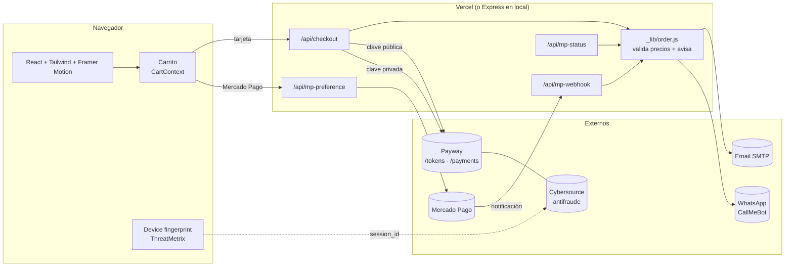
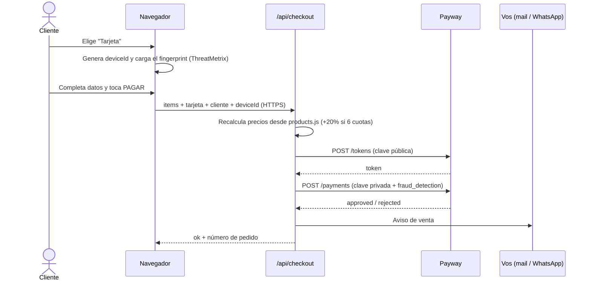
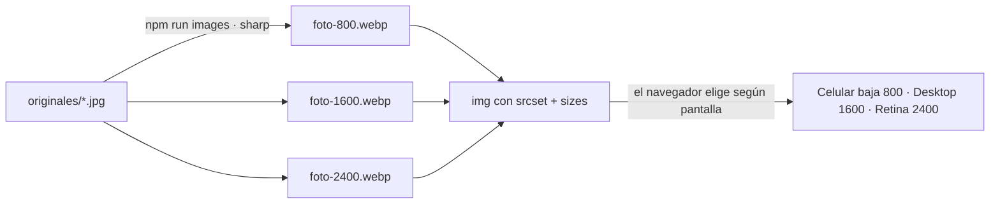

# CARMOTION — Landing + tienda online

Sitio de CARMOTION (cobertores plegables para autos, camionetas, motos y UTVs) con estética "Rolex": fondo negro, acentos dorados `#C9A84C`, animaciones lentas. Incluye carrito y cobro online con **Payway** (tarjeta) y **Mercado Pago**.

---

## Tecnologías

| Capa | Tecnología | Para qué se usa |
|---|---|---|
| UI | **React 18** | Componentes de cada sección (`src/components/*Rolex.jsx`) |
| Build / dev server | **Vite 5** | Servidor de desarrollo con recarga al instante y build optimizado a `dist/` |
| Estilos | **Tailwind CSS 3** + PostCSS + Autoprefixer | Clases utilitarias, diseño responsive |
| Animaciones | **Framer Motion 10** | Apariciones al hacer scroll, header que se oculta, lightbox, transiciones |
| Tipografías | Archivo Black (títulos), Lato (texto), monoespaciada (etiquetas) | |
| API (pagos) | **Funciones serverless de Node** en `api/` | Formato Vercel: cada archivo es un endpoint `/api/...` |
| API en local | **Express 5** (`server/dev-server.js`) | Corre las mismas funciones en `localhost:4000` |
| Pago con tarjeta | **Payway** (ex Decidir) API v2 + antifraude **Cybersource** | Tokeniza la tarjeta y cobra; cuotas 1/3 sin interés, 6 con 20% de recargo |
| Pago alternativo | **Mercado Pago Checkout Pro** | Redirige al checkout de MP; webhook confirma el pago |
| Avisos de venta | **Nodemailer** (SMTP/Gmail) + **CallMeBot** (WhatsApp) | Te avisa cada venta aprobada |
| Imágenes | **sharp** (`npm run images`) | Convierte las fotos a WebP en 800/1600/2400 px |
| Videos | **ffmpeg** (manual) | H.264 comprimido + póster WebP |
| Hosting | **Vercel** (proyecto `carmotion-rolex`) | Sirve `dist/` + las funciones de `api/` |

---

## Arquitectura



### Flujo de un pago con tarjeta



> Los precios **nunca** se toman del navegador: el server los recalcula con `src/data/products.js`. La tarjeta no se guarda en ningún lado.

### Imágenes responsive



---

## Estructura

```
carmotion-ROLEX/
├── api/                      # Funciones serverless (pagos)
│   ├── checkout.js           # Payway: token + pago + antifraude
│   ├── mp-preference.js      # Mercado Pago: crea la preferencia
│   ├── mp-webhook.js         # Mercado Pago: notificación de pago
│   ├── mp-status.js          # Mercado Pago: consulta al volver
│   └── _lib/                 # Validación de pedido, avisos, cliente MP
├── server/dev-server.js      # Express para correr api/ en local
├── src/
│   ├── AppRolex.jsx          # Arma la página
│   ├── components/*Rolex.jsx # Header, Hero, Galería, Precios, YouTube, Checkout, Footer...
│   ├── context/CartContext.jsx
│   ├── data/products.js      # Catálogo, precios y cuotas (fuente de verdad)
│   ├── data/images.json      # Medidas de cada foto optimizada
│   └── utils/                # srcset de imágenes, device fingerprint
├── public/
│   ├── images/opt/           # WebP generados (800/1600/2400)
│   └── videos/               # MP4 comprimidos + pósters
├── originales/               # Fotos originales (no se publican)
├── scripts/optimize-images.mjs
└── dist/                     # Build de producción (se commitea)
```

---

## Uso

```bash
npm install
npm run dev       # frontend en http://localhost:3000
npm run dev:api   # API de pagos en http://localhost:4000 (Vite le pasa /api)
npm run build     # build de producción en dist/
npm run images    # regenerar WebP desde originales/
```

Variables de entorno: copiar `.env.example` a `.env` y completar (Payway, Mercado Pago, SMTP, WhatsApp). En producción se cargan en **Vercel → Settings → Environment Variables**. Nunca commitear `.env`.

### Pasar a producción
1. `PAYWAY_ENV=production`, `VITE_PAYWAY_ENV=production` y las claves productivas de Payway (`PAYWAY_PUBLIC_KEY`, `PAYWAY_PRIVATE_KEY`, `PAYWAY_SITE_ID`, `PAYWAY_TEMPLATE_ID`, `PAYWAY_API_URL`)
2. Claves productivas de Mercado Pago y `PUBLIC_URL`
3. Avisos: `SMTP_*`/`ORDER_EMAIL_TO` y/o `WHATSAPP_NOTIFY_PHONE` + `CALLMEBOT_APIKEY`
4. Confirmar con Payway el `org_id` del device fingerprint (por defecto `k8vif92e` en producción; se puede cambiar con `VITE_PAYWAY_FP_ORG_ID`)
5. Mergear `checkout` → `main` y deployar

---

Desarrollado por NicoDeF.
